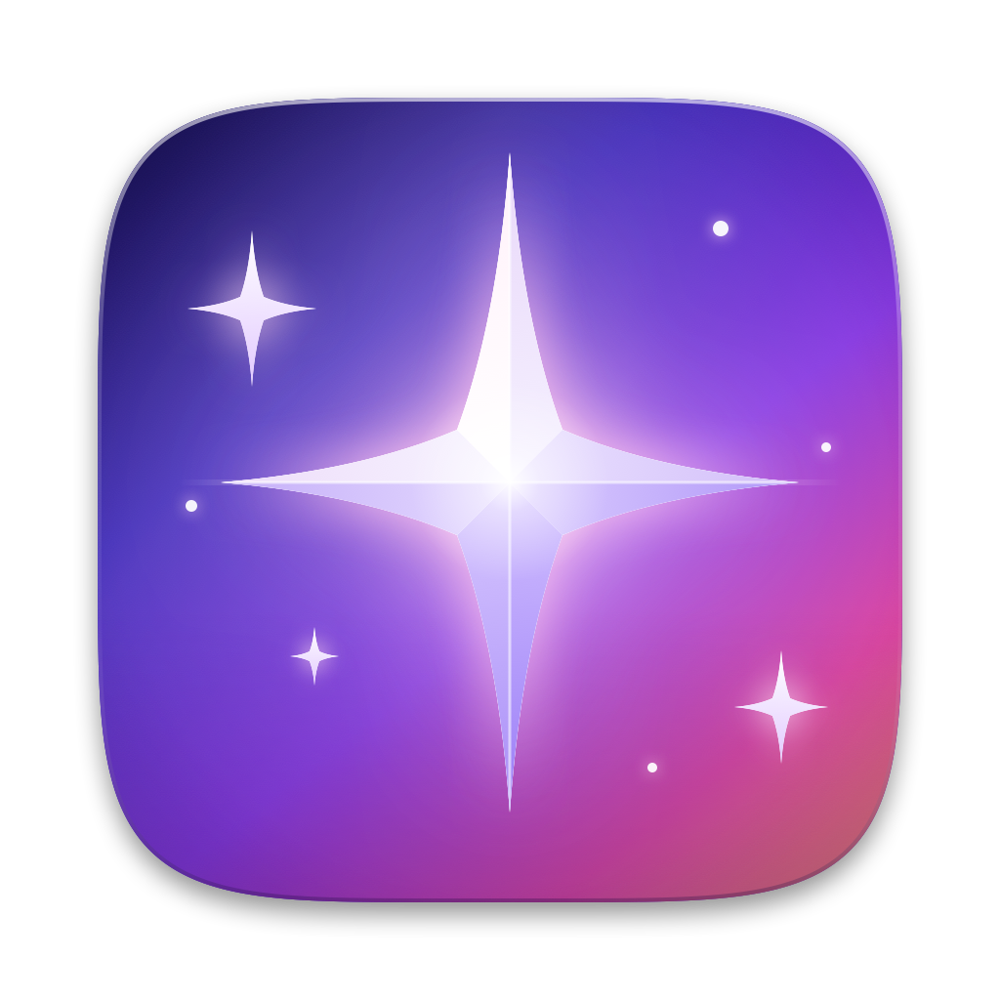

<p align="center"></p>

# Glint

Open-source screenshot beautifier for macOS. Capture an area, window or screen, then turn it into a polished image with backgrounds, padding, shadows, annotations and automatic redaction of sensitive text. Everything runs locally. Nothing is uploaded.

Glint is an independent project, released under the MIT license. It is not affiliated with or endorsed by any other screenshot product.

## Install

```sh
brew tap MrAshRhodes/tap
brew install --cask glint
```

Or download `Glint-<version>.zip` from the [Releases](https://github.com/MrAshRhodes/glint/releases) page and drag `Glint.app` to `/Applications`.

The app is ad-hoc signed, not notarized. The Homebrew cask clears the quarantine flag for you. If you install manually and macOS refuses to open it, run `xattr -dr com.apple.quarantine /Applications/Glint.app`.

Requires macOS 14 or later. On first launch grant **Screen Recording** permission (System Settings → Privacy & Security).

## Features

- **Capture**: area (crosshair overlay), window picker, full screen, repeat last area, timer (3/5/10 s), capture text (OCR to clipboard). Multi-display and Retina aware.
- **Global hotkeys**: ⌃⌥⌘4 area, ⌃⌥⌘5 window by default. All rebindable.
- **Beautify**: 32 built-in backgrounds (gradients, mesh, patterns, solid, transparent, your own image), padding, inset, corner radius, two-layer shadow, 3D tilt, rotate/flip, window frames, watermark.
- **Auto-balance**: detects uniform borders and balances the margins.
- **Aspect ratios**: auto, 1:1, 4:3, 3:2, 16:9, 9:16, 4:5, and social presets, plus custom.
- **Annotations**: arrow, line, rectangle, ellipse, pen, highlighter, text, numbered counters, and redaction (blur, pixelate, solid). Undo/redo, z-order, per-object styling.
- **Auto-redact**: on-device Vision OCR finds emails, phone numbers, credit cards (Luhn-checked), IP addresses, API keys and tokens, and redacts them. Redactions destroy the pixels on export.
- **Presets**: save, apply and set a default look.
- **Export**: PNG, JPEG, HEIC, TIFF; 1x/2x; clipboard; Save As; share sheet; drag out. Optional raw and output folders.
- **Automation**: `glint://capture-area`, `capture-window`, `capture-fullscreen`, `capture-text`, `open?file=…`, and a CLI:

```sh
Glint.app/Contents/MacOS/Glint --render in.png out.png --preset "Social 16:9" --scale 2
Glint.app/Contents/MacOS/Glint --list-presets
Glint.app/Contents/MacOS/Glint --diagnose
```

## Build from source

```sh
make app        # dist/Glint.app
make universal  # arm64 + x86_64
make test
make run
```

See [CONTRIBUTING.md](CONTRIBUTING.md) for architecture and environment notes.

## License

MIT. See [LICENSE](LICENSE).
