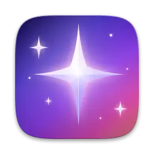
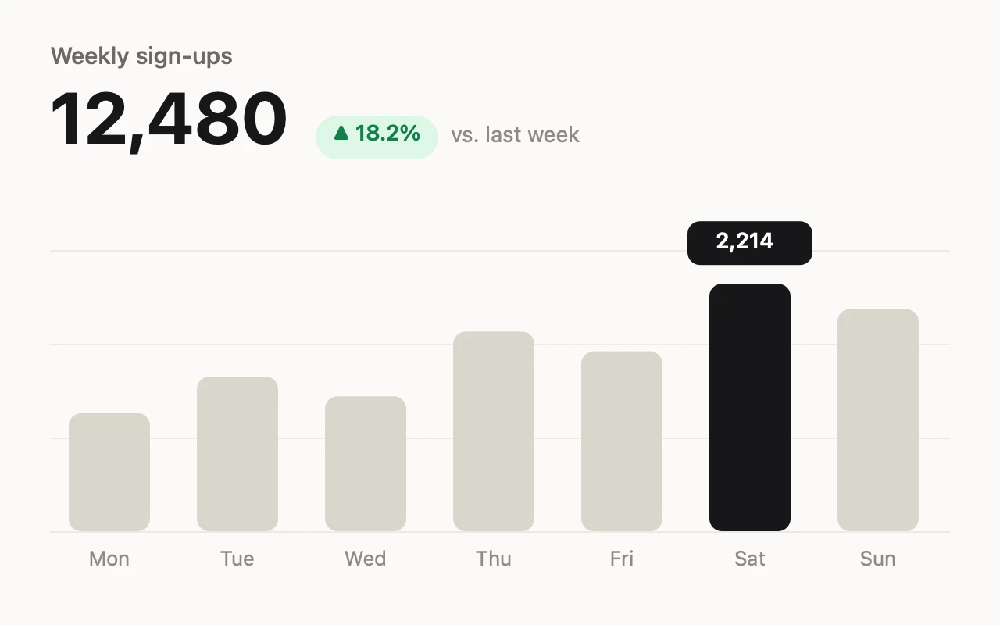
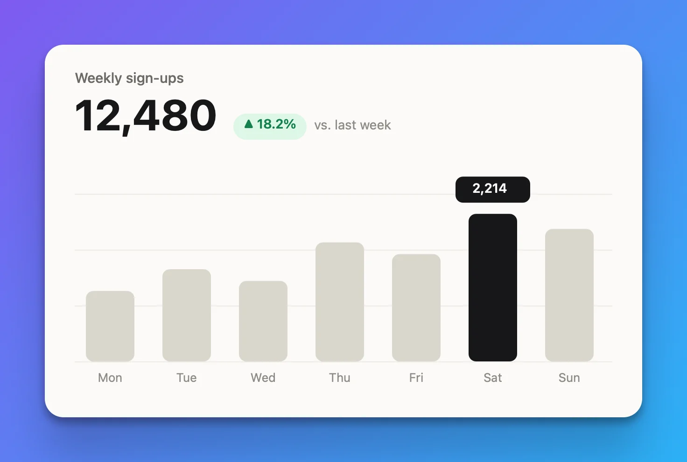

<p align="center"></p>

# Glint

**Free, open-source screenshot beautifier for macOS.**

Capture an area, window or screen, or record a short clip, then add backgrounds, padding, shadows, annotations and redaction. Screenshot and recording processing stays on your Mac. Glint does not upload your images or recordings.

[](https://github.com/MrAshRhodes/glint/actions/workflows/ci.yml)
[](https://github.com/MrAshRhodes/glint/releases/latest)
[](LICENSE)
[](https://mrashrhodes.github.io/glint/guide.html#install)
[](https://github.com/MrAshRhodes/homebrew-tap)

**[Product site](https://mrashrhodes.github.io/glint/)** · **[User guide](https://mrashrhodes.github.io/glint/guide.html)** · **[Releases](https://github.com/MrAshRhodes/glint/releases/latest)** · **[Changelog](CHANGELOG.md)**

| Before | After |
| --- | --- |
|  |  |

Example output using original sample artwork, not a screenshot of the editor. [Try the before/after preview](https://mrashrhodes.github.io/glint/#table-title).

## Install

```sh
brew tap MrAshRhodes/tap
brew install --cask glint
```

Or install manually from the [Releases](https://github.com/MrAshRhodes/glint/releases) page. Download `Glint-<version>.zip` and its matching `Glint-<version>.zip.sha256` from the same release. For a DMG instead, download `Glint-<version>.dmg` and `Glint-<version>.dmg.sha256`. Keep the pair in the same folder without renaming either file.

Before extracting the ZIP or opening the DMG, open Terminal and change to that folder (for example, `cd ~/Downloads`). Replace `<version>` with the downloaded release's version and run **only the command for your chosen format**:

**ZIP:**

```sh
shasum -a 256 -c "Glint-<version>.zip.sha256"
```

**DMG (instead of ZIP):**

```sh
shasum -a 256 -c "Glint-<version>.dmg.sha256"
```

Continue only if the command succeeds and reports `Glint-<version>.zip: OK` (or `Glint-<version>.dmg: OK`). **If verification fails for any reason, including a mismatch or a missing archive or checksum, stop. Do not install the app or clear quarantine.** Download the matching pair again from the official release and verify again.

After successful verification, extract the ZIP or open the DMG and drag `Glint.app` to `/Applications`. A matching checksum confirms agreement with the published checksum; it is not notarization or proof that the app is safe.

Releases from **1.5.4** onward are signed with an Apple Developer ID certificate and notarized by Apple, with Gatekeeper checks preserved; the Homebrew cask no longer clears the quarantine flag. Releases **1.5.3 and earlier are legacy, unnotarized builds** and are not retroactively replaced. If macOS rejects an app, stop and investigate rather than clearing quarantine or bypassing a warning.

Requires macOS 14 or later. On first launch grant **Screen Recording** permission (System Settings → Privacy & Security). Subsequent Developer ID updates use the same signing requirement to preserve the permission; the transition from legacy builds needs one re-grant.

## Updates

Direct downloads released after **1.5.5** can update themselves with [Sparkle](https://sparkle-project.org). A copy installed with Homebrew is left to Homebrew. Glint never downloads or installs an update without asking first.

- **Check by hand:** choose **Check for Updates…** from the menu bar menu or the app menu, or **Check Now** in Preferences → About. If a newer release exists, Glint shows what changed and asks before it downloads the update, then again before it installs it and relaunches.
- **Check on a schedule (optional):** automatic checks are **off** by default, so a new installation contacts nothing until you check by hand. To turn them on, pick **Daily**, **Weekly** or **Monthly** under **Check for updates automatically** in Preferences → About; pick **Never** to turn them off again. A scheduled check still asks before downloading anything.
- **Verified first:** the update feed and every update archive are signed with Glint's update signing key, and Glint rejects anything whose signature doesn't match. Sparkle also checks the new app's code signature before installing it. A check fetches one feed file from GitHub; Glint sends no system profile with it.

For a Homebrew installation, Glint never replaces itself, so Homebrew's records stay correct. **Check for Updates…** shows this command with a **Copy Command** button. Save your work, quit Glint, then run:

```sh
brew update && brew upgrade --cask glint
```

Reopen Glint afterward. `brew update` refreshes Homebrew's package list; only `brew upgrade` installs the newer app. A release must also be published to the Homebrew tap before it appears there. To move an installation between Homebrew and a direct download, see [Switching an install between Homebrew and direct downloads](https://mrashrhodes.github.io/glint/guide.html#switching-installs).

**Glint 1.5.5 and earlier can't update themselves.** Update once with Homebrew as above, or save your work, quit Glint and download the latest ZIP or DMG and its matching `.sha256` file. Follow the [verification steps above](#install) before extracting or opening the download and replacing `/Applications/Glint.app`, then reopen Glint. Your separately stored preferences, presets and images remain in place. From then on, a downloaded copy can update itself. Source builds without the release update key explain that they can't update themselves. See the [update guide](https://mrashrhodes.github.io/glint/guide.html#updates).

**Updating from 1.5.3 or earlier to 1.5.4 or later** changes the signing requirement, so macOS needs Screen Recording permission once more. Choose **Re-authorize Screen Recording…** in Preferences → About (Glint also opens its setup window if a capture fails for lack of access), allow Glint in System Settings, then relaunch Glint. If macOS cannot reset the old entry, Glint explains how to remove it and add it back manually. Subsequent Developer ID updates are expected to keep the permission ([#44](https://github.com/MrAshRhodes/glint/issues/44)).

## Features

- **Capture**: area (crosshair overlay), window picker, full screen, repeat last area, timer (3/5/10 s), scrolling capture, capture text (OCR to clipboard). OCR notifications confirm copying without previewing recognized text. Multi-display and Retina aware. Immediate selections preserve the screen before taking focus so menus and floating pop-ups can be included. To capture Glint's editor, turn off **Hide Glint windows while capturing** (on by default). Timers remain live; see [capturing open menus and Glint itself](https://mrashrhodes.github.io/glint/guide.html#capturing-menus) for shortcut and entry-point limitations.
- **Selection snapping**: opt in with **Snap to Edges** in the menu bar or **Snap selection to edges** in Preferences → Capture. Area selections align to visible window bounds and display edges, with snap guides. Hold ⌘ to temporarily invert snapping; Shift still constrains to a square. Snapping is off by default and does not detect arbitrary content inside windows.
- **Global hotkeys**: ⌃⌥⌘4 area to editor, ⌃⌥⌘5 area to clipboard, ⌃⌥⌘6 window, ⌃⌥⌘3 full screen, ⌃⌥⌘7 OCR, ⌃⌥⌘R repeat last area, ⌃⌥⌘9 record screen (start, stop), ⌃⌥⌘8 scrolling capture (start, finish). All rebindable.
- **Screen recording**: choose **Record Screen…** in the menu bar or press ⌃⌥⌘9, select and adjust an area, then record right away or after a 3, 5 or 10 second countdown. A floating bar shows the elapsed time and a Stop button; the same shortcut and the menu bar item also stop it. Recordings are video only (no audio), stop automatically at 10 minutes, and leave Glint's own windows out. The finished clip opens in the same editor as screenshots, so the annotation tools, frames, backgrounds, presets and every other style apply to it; trim it, then export an animated GIF or an MP4, or copy, save, share or drag it out. Annotations cover the whole clip by default; adjust each annotation's range in the timeline, enter source seconds, or use Shift+I / Shift+O at the playhead. Time-limited redactions expose content outside their range, so review the whole clip before sharing. Solid and Pixelate redactions can **track** moving content: select one and choose **Track** to follow it from the current frame, on this Mac. Frames the tracker isn't sure about are flagged in orange, covered by a large fail-safe rect, and block every export until you accept the fixed cover or correct them with keyframes; trimming them out also works. Blur can't be tracked. Tracking is an aid, and you remain responsible for checking every frame. Automatic redaction and Auto-balance are off for recordings, so review what is on screen before you record. See [recording a clip](https://mrashrhodes.github.io/glint/guide.html#recording).
- **Scrolling capture**: choose **Scrolling Capture** in the menu bar or press ⌃⌥⌘8 and select the scrolling area. Glint automatically scrolls in small steps, waiting for capture and stitching before advancing; this needs Accessibility permission. Turn off **Automatically scroll during scrolling capture** in Preferences → Capture to scroll manually without that extra permission; the floating panel provides too-fast, too-slow and steady-pace guidance alongside the stitched preview and height. Press the shortcut again or **Done** to finish, or Esc to cancel. Sticky headers and footers appear once. If a match is uncertain, scrolling stops or the target window changes, Glint pauses for review; **Resume** continues manually, with **Undo** and **Retry** for join recovery. Captures stop at 16,384 pixels high or 64 megapixels and open in the editor, where **Fit**, **Fit Width** and **100%** zoom (⌘9, ⌘8, ⌘0) help with tall images. See [scrolling capture](https://mrashrhodes.github.io/glint/guide.html#scrolling-capture).
- **Recording presentation**: add click ripples, a pointer halo or spotlight and smooth zoom segments. With **Editable pointer** on (Preferences → Capture), the pointer can also be enlarged or hidden. Effects follow trimming, and source-anchored annotations and tracked redactions keep covering their content during zooms.
- **Beautify**: 32 built-in backgrounds (gradients, mesh, patterns, solid, transparent, your own image), padding, inset, corner radius, two-layer shadow, 3D tilt, rotate/flip, window, device and playful frames (macOS, browser, code editor, terminal, phone, retro monitor, pixel arcade, handheld console, comic panel, film strip, photo print), watermark.
- **Desktop wallpaper**: check **Use desktop wallpaper** in the Background controls to use your system wallpaper without importing a file. Preview and export share the same image; uncheck it to restore your previous background. See [wallpaper behavior and limitations](https://mrashrhodes.github.io/glint/guide.html#desktop-wallpaper).
- **Auto-balance**: detects uniform borders and balances the margins.
- **Aspect ratios**: auto, 1:1, 4:3, 3:2, 16:9, 9:16, 4:5, and social presets, plus custom.
- **Annotations**: arrow, line, rectangle, ellipse, pen, highlighter, text, numbered counters, **Zoom**, and a **Redact / Obfuscate** tool. Each toolbar button shows its shortcut key: **Select** `V`, **Text** `1`, **Arrow** `2`, **Redact / Obfuscate** `3`, **Shape** `4`, **Zoom** `Z`, **Pen** `P`, **Highlighter** `H`, **Counter** `C`. **Zoom** (`Z`; press again for circle or rectangle) magnifies a selected detail 2× by default (1.25×–8×) in a movable inset beside it; the canvas grows automatically to fit an inset placed outside the screenshot, and insets never reveal redacted pixels. See [Zoom in on a detail](https://mrashrhodes.github.io/glint/guide.html#zoom). Click the current-style label to choose **Solid**, **Blur**, or **Pixelate**; the icon and `3` activate the tool without cycling styles. Each image starts with plain Solid. Solid offers an optional two-colour checkerboard; Pixelate uses an opaque decorative mosaic independent of the source image, with an optional solid-colour accent. Both replace covered pixels. **Blur is obfuscation only and unsafe for secrets.** Undo/redo, z-order, per-object styling.
- **Auto-redact**: on-device Vision OCR finds emails, phone numbers, credit cards (Luhn-checked), IP addresses, API keys and tokens, and covers detected regions with fully opaque solid fill, regardless of the manual tool mode. Solid redaction replaces the covered pixels in the exported image. Detection can miss information: review before sharing. Original images and saved raw captures are not erased.
- **Presets**: save, apply and set a default look. Create or edit presets from Preferences → Presets with live previews on a built-in sample image (or your own), then fine-tune them in the Preset Designer. **Remember settings** in Preferences → Editor starts each new screenshot with your last-used look, whether or not the editor opens (a screenshot exported automatically or copied straight to the clipboard starts from the same look); turn it off to always start from the default preset.
- **Export**: PNG, JPEG, HEIC, TIFF; 1x/2x; clipboard; Save As; share sheet; drag out. Optional raw and output folders.
- **Reopen Last Image**: opt in with **Keep copied and dragged screenshots for reopening** in Preferences → Output (off by default) and Glint keeps the finished image, annotations and redactions included, whenever you copy it or drag it out, including clipboard-only captures. **Reopen Last Image**, next to **Open Image…** and **Open Recent** in the menu bar menu and in the File menu, opens it again after the clipboard changes, the editor closes or Glint restarts. It opens as a flattened result, so a frame or background is never applied twice. It needs **Keep history**, reuses the file **Save styled output** already wrote instead of adding a duplicate, never keeps the original capture, and leaves **Save untouched raw capture** images alone. Installing or upgrading changes nothing until you opt in. See the [user guide](https://mrashrhodes.github.io/glint/guide.html#reopen-last-image).
- **Editable projects**: **Save as Project…** (⌥⌘S, in the editor or the File menu) saves a `.glint` project with the original capture or recording, your look, every annotation and, for recordings, the trim, annotation ranges, export settings and presentation tools (pointer samples, clicks, cursor effects and zooms). Reopen it with **Open Image…**, **Open Recent** or a double-click in Finder and everything is editable again; no preset, remembered look or auto-redaction is applied on top. Tracked redactions keep their tracking: a reopened recording still shows each tracked position and the orange flagged frames, and blocks every export until they are accepted, corrected with keyframes or trimmed out. Older builds refuse projects with tracking or presentation data they cannot preserve, with a message to update. **Projects contain the original capture, including anything you redacted**, so share an exported image or clip instead. See [editable projects](https://mrashrhodes.github.io/glint/guide.html#projects).
- **Output retention**: **Keep screenshots in Output for** lets kept images expire after Forever (the default), 1, 7, 30 or 90 days. Glint moves to the Trash only images it saved itself after you opted in; Raw captures, manual saves and exports, and files that were already in the Output folder are never removed. See [how cleanup works](https://mrashrhodes.github.io/glint/guide.html#output-retention).
- **Safe retry**: failed exports keep the image and annotations in the editor with a **Retry** action. If capture auto-redaction or rendering fails, choose **Retry** or **Discard Capture**. Recovery stays in memory while the editor or prompt is open; it never creates an unredacted backup or bypasses redaction.
- **Automation**: `glint://capture-area`, `capture-window`, `capture-fullscreen`, `capture-text`, `capture-scrolling`, `repeat-last`, `open?file=…`, and a CLI. Every capture URL requires confirmation before Glint captures, saves or copies anything, even with Screen Recording permission. Cancel leaves the screen uncaptured; there is no "always allow" option. Capture URLs received while confirmation or capture is in progress are rejected, not queued; send a new request afterward. Menu/hotkey captures, non-capture URLs and CLI rendering are unchanged:

```sh
Glint.app/Contents/MacOS/Glint --render in.png out.png --preset "Social 16:9" --scale 2
Glint.app/Contents/MacOS/Glint --list-presets
Glint.app/Contents/MacOS/Glint --diagnose
Glint.app/Contents/MacOS/Glint --diagnose --timing
```

`--diagnose` checks Screen Recording permission without requesting access and prints only permission state,
aggregate display/window/application counts, and fixed status messages. It does not print window titles,
app identities, process/window/display identifiers, or per-display details. Review reports before sharing:
aggregate counts still describe your desktop activity.

`--diagnose --timing` also prints JSON with the cold and warm timings of the capture-to-export stages, each with its
sample count, p50 and p95 in milliseconds: the ScreenCaptureKit content query (`shareable_content`), one display grab
(`display_grab`), the window list behind snapping (`selection_snapshot`), and the styled render plus PNG encode
(`render_and_encode`). A **cold** timing is a stage's first run in a freshly launched Glint process, one process per
run, so the operating system's caches are not reset; a **warm** timing is a repeat in one process after one discarded
warm-up. `--timing-iterations N` sets the warm repeats (20 to 1000, default 50) and `--timing-cold-runs N` the fresh
processes (0 to 100, default 20). Glint reads display pixels only when you add `--allow-screen-capture`; without it
`display_grab` is skipped and `render_and_encode` works on a generated 2880 × 1800 frame. Stages that need Screen
Recording permission are skipped when it is not granted, and the command never requests it. The report contains
durations, counts and fixed strings only, with no window titles, display names, error text or pixels.

## Build from source

```sh
make app        # dist/Glint.app
make universal  # arm64 + x86_64
make test
make run
```

See [CONTRIBUTING.md](CONTRIBUTING.md) for architecture and environment notes.

## Contributing

Bug reports, ideas, documentation and code contributions are welcome. Start with
the [contribution guide](CONTRIBUTING.md) and [Code of Conduct](CODE_OF_CONDUCT.md).
Every pull request must link a real issue; discuss the change there first.

## Support

See the [user guide](https://mrashrhodes.github.io/glint/guide.html) for installation,
updates and troubleshooting. Search [existing issues](https://github.com/MrAshRhodes/glint/issues)
before [reporting a bug or requesting a feature](https://github.com/MrAshRhodes/glint/issues/new/choose).
Use synthetic examples and remove private information from attachments.

## Security

Report suspected vulnerabilities privately, not in a public issue.
See the [security policy](SECURITY.md) and
[private reporting form](https://github.com/MrAshRhodes/glint/security/advisories/new).

## License

MIT. See [LICENSE](LICENSE).

Glint is an independent project. It is not affiliated with or endorsed by any other screenshot product.
